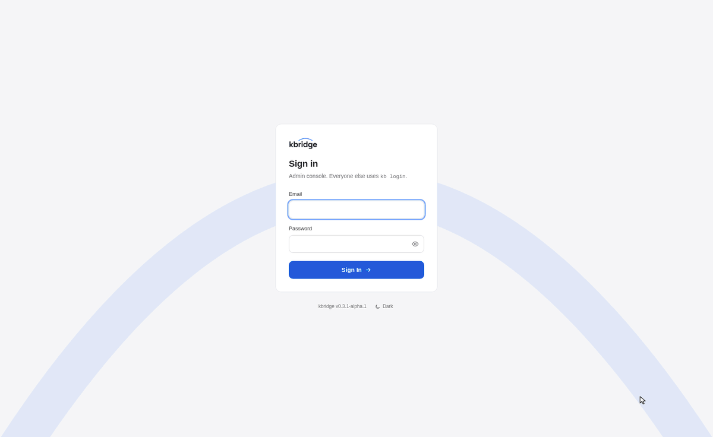

<picture>
  <source media="(prefers-color-scheme: dark)" srcset="docs/assets/kbridge-logo-dark.svg">
  
</picture>


A lightweight access gateway that lets you manage multiple Kubernetes clusters from a central control plane, without needing to distribute kubeconfig files, open inbound firewall rules, or set up VPN access.

<picture>
  <source media="(prefers-color-scheme: dark)" srcset="docs/assets/demo.gif">
  
</picture>

> **Status: alpha** (`v0.3.1-alpha.1`). Config keys, the RBAC policy schema,
> and REST API paths may change between releases, and it is not yet recommended
> for unattended production use.

## How it works

<picture>
  <source media="(prefers-color-scheme: dark)" srcset="docs/assets/architecture.gif">
  
</picture>

1. **Each cluster runs a small agent** that dials out to the control plane over
   gRPC. No inbound port is opened and no kubeconfig leaves the cluster.
2. **You run `kb` with kubectl syntax.** The CLI sends your login token and the
   command to the control plane.
3. **The control plane checks the command**: the role rules decide whether it
   runs. Nothing reaches a cluster without passing this one chokepoint.
4. **The agent runs kubectl as you.** kubectl holds no credential of its own; it
   goes through a loopback proxy in the agent that impersonates
   `kbridge:<your email>`, so the cluster's RBAC and its own audit log see the
   user, not the agent. The agent keeps RoleBindings in step with the policy.
5. **The result comes back and the attempt is recorded**, whether it ran or was
   refused: user, cluster, command, and outcome, in the kbridge audit log.

One-shot commands are queued and polled by the agent. `logs -f`, `exec -it`, and
port-forward run over one persistent stream between agent and control plane and
HTTP/2 streams between CLI and control plane.

<!-- Console recording: docs/assets/console.gif and console-light.gif are recorded separately. -->
<picture>
  <source media="(prefers-color-scheme: dark)" srcset="docs/assets/console.gif">
  
</picture>

The kbridge admin account also gets a read-only web console at the control
plane root (`/`): cluster health, the audit log, agent tokens, and users. See
[docs/console.md](docs/console.md).

## Install

The CLI, on Linux or macOS:

```bash
curl -fsSL https://raw.githubusercontent.com/why-xn/kbridge/master/install.sh | sh
```

`kb` talks to a control plane someone has already deployed, with an account
they created for you. To run your own, follow the Helm quick start in
[docs/installation.md](docs/installation.md) first.

No configuration file to write: the first login asks for the control plane
URL and saves it, with your session, in `~/.kbridge/config.yaml`.

```bash
kb login
# Control plane URL: https://kbridge.example.com
# Email: you@example.com
# Password:
# Login successful.
kb clusters list
kb clusters use <cluster>
kb get pods -n <namespace>
```

The control plane and the per-cluster agent ship as Helm charts. See
[docs/installation.md](docs/installation.md) for binaries, images, and charts,
[docs/production-install.md](docs/production-install.md) for TLS and secrets,
and [Quick Start](#quick-start) to build and run everything from source.

## Problem

Giving an engineer access to a Kubernetes cluster usually means handing out a
kubeconfig or exposing the API server. That creates four problems that compound
with every new cluster, team, and environment.

- **Credential sprawl.** Every developer needs a kubeconfig for every cluster.
  Distributing, rotating, and revoking those credentials does not scale, and a
  credential on a laptop is a credential that can leak.
- **Network exposure.** Cluster API servers sit behind firewalls, so granting
  access means a VPN, a bastion, or a public endpoint. Each one is more attack
  surface to maintain.
- **Standing access, and no way to stop a mistake.** Permissions are granted
  once and kept forever, and Kubernetes RBAC decides only whether a *verb* on a
  *resource* is allowed. It cannot tell `delete pod api-0` from
  `delete pod --all`, so a single mistaken command reaches the cluster and the
  first anyone knows of it is the outage.
- **Records that do not answer the question.** Reconstructing who did what means
  stitching together logs from several clusters. And when the actor is an AI
  agent using a shared credential, the cluster's own audit log cannot say which
  human was behind it.

That last point is getting sharper. Teams are already letting AI agents inspect
and change infrastructure, often by handing them long-lived credentials, which
recreates every problem above at machine speed.

## Solution

kbridge puts a **control plane** between people and clusters. Nobody holds
cluster credentials: the user runs a CLI, each cluster runs a small agent that
dials *outbound*, and every command is checked before it is forwarded. No inbound
ports, no kubeconfig distribution, no VPN.

1. **Control plane (`kbridge-control-plane`)** authenticates the user, decides
   whether the command may run, routes it, and records the outcome. The one place
   access is granted and revoked.
2. **Cluster agent (`kbridge-agent`)** runs inside each cluster, opens an
   outbound gRPC connection, runs approved commands with kubectl as the
   requesting user, and returns the result. Because it dials out, no firewall
   change is needed, and because it holds the credentials, the control plane
   never does.
3. **CLI (`kb`)** speaks REST to the control plane with familiar kubectl syntax,
   so `kb get pods` works with no local credentials and no network path to the
   cluster.

What that changes:

| Problem | What kbridge does |
|---|---|
| Credential sprawl | Users authenticate to the control plane; cluster credentials never leave the agent, and access is revoked centrally |
| Network exposure | The agent dials out, so no inbound port, bastion, or VPN is required |
| Records that do not answer the question | One audit log across every cluster: who ran which command where, and whether it ran |

See the [roadmap](https://github.com/why-xn/kbridge/blob/master/ROADMAP.md)
on `master` for what is shipped, in progress, and planned.

## Components

### CLI (`kb`)

User-facing command-line tool. **kubectl by default** — anything that isn't a
management command (`login`, `logout`, `status`, `clusters`, `admin`) is run as
kubectl on the selected cluster. (`make build` also creates a `kbridge` symlink
for back-compat; the installer and the release archives ship `kb` only.)

```bash
kb login                      # Login to the control plane
kb logout                     # Logout
kb clusters list              # List available clusters
kb clusters use <cluster>     # Select active cluster
kb get pods                   # Run kubectl on the selected cluster
kb apply -f app.yaml          # Any kubectl command works
kb logs -f deploy/api         # Follow/watch (-f/-w) streams live until Ctrl-C
kb exec -it deploy/api -- sh  # Interactive shell (full TTY; -i for stdin-only)
kb port-forward deploy/db 5432:5432  # Forward pod port to localhost
kb kubectl get pods           # 'kubectl'/'k' force kubectl explicitly
kb status                     # Show current context

# Admin (requires the kbridge admin account)
kb admin users list                          # List users
kb admin users create --email dev@corp.com --name Dev
kb admin agent-tokens create --cluster prod  # Generate an agent token
kb admin audit --user dev@corp.com           # View the command audit log
kb admin rbac status                         # Show RoleBinding sync state per cluster
```

### Control Plane (`kbridge-control-plane`)

API gateway and control plane. Handles user authentication, cluster registry, RBAC enforcement, command proxying, and audit logging.

### Agent (`kbridge-agent`)

Lightweight daemon running in each Kubernetes cluster. Connects outbound to the control plane, registers cluster metadata, polls for commands, executes kubectl locally as the requesting user (impersonation), keeps cluster RoleBindings in step with kbridge policy, and submits results back. It holds only impersonation and binding-sync permissions.

## Quick Start

### Prerequisites

- Go 1.25+
- kubectl installed
- Access to a Kubernetes cluster

### Build

```bash
make build
```

This produces three binaries in `bin/`:
- `kb` - CLI tool (with a `kbridge` symlink for back-compat)
- `kbridge-control-plane` - control plane
- `kbridge-agent` - Cluster agent

### Run Locally

**1. Start the control plane:**
```bash
# Control Plane requires a real jwt_secret (>=32 chars). Generate one:
export KBRIDGE_JWT_SECRET="$(openssl rand -hex 32)"
./bin/kbridge-control-plane --config configs/control-plane.yaml
```

**2. Start an agent (locally, uncomment the `kubernetes:` block in `configs/agent.yaml` and set `kubeconfig:` to the absolute path of your kubeconfig; in a pod the in-cluster defaults apply):**
```bash
./bin/kbridge-agent --config configs/agent.yaml
```

**3. Log in and use the CLI:**
```bash
# Default admin is seeded from control-plane.yaml (admin@kbridge.local / admin123 in
# the example config — change admin_password after first login for any real deployment).
./bin/kb login
./bin/kb clusters list
./bin/kb clusters use dev-cluster
./bin/kb get pods -A
```

Admins can also open the read-only console at `http://localhost:8080/`
(or `https://<control-plane>/` in a real install; see
[docs/console.md](docs/console.md)).

See [docs/installation.md](docs/installation.md) for binary, Docker, and Helm
installs, and the [Documentation](#documentation) section below for full references.

## Configuration

### Control Plane (`control-plane.yaml`)

```yaml
server:
  http_port: 8080                  # REST API port
  grpc_port: 9090                  # gRPC server port
database:
  driver: sqlite
  path: kbridge.db
auth:
  jwt_secret: ""                   # required, 32+ chars; or set KBRIDGE_JWT_SECRET
  admin_email: admin@kbridge.local # seeded on first start
  admin_password: admin123         # change after first login
rbac:
  policy_file: configs/rbac.yaml   # empty = enforcement disabled
tls:
  enabled: false                   # see docs/configuration.md#tls
```

See [docs/configuration.md](docs/configuration.md) for the complete reference
(audit, bootstrap, TLS, env vars).

### Agent (`agent.yaml`)

```yaml
control_plane:
  url: localhost:9090              # control plane gRPC address
  token: dev-token                 # Authentication token

cluster:
  name: dev-cluster                # Unique cluster identifier
```

### CLI (`~/.kbridge/config.yaml`)

```yaml
control_plane_url: https://control-plane.example.com:8080
current_cluster: production-us-east
token: ""
```

### Environment Variables

**Agent:**

| Variable | Description | Default |
|----------|-------------|---------|
| `KBRIDGE_CONFIG` | Path to config file | `configs/agent.yaml` or `/etc/kbridge/agent.yaml` |
| `KBRIDGE_CONTROL_PLANE_URL` | control plane gRPC address | `localhost:9090` |
| `KBRIDGE_AGENT_TOKEN` | Authentication token | — |
| `KBRIDGE_CLUSTER_NAME` | Cluster name | `default` |

**control plane:**

| Variable | Description | Default |
|----------|-------------|---------|
| `KBRIDGE_CONFIG` | Path to config file | `configs/agent.yaml` or `/etc/kbridge/agent.yaml` |
| `KBRIDGE_CONTROL_PLANE_URL` | control plane gRPC address | `localhost:9090` |
| `KBRIDGE_AGENT_TOKEN` | Authentication token | — |
| `KBRIDGE_CLUSTER_NAME` | Cluster name | `default` |

**control plane:**

| Variable | Description | Default |
|----------|-------------|---------|
| `KBRIDGE_CONFIG` | Path to config file (`--config` wins) | none: with neither, the control plane runs on built-in defaults, with RBAC off and no seeded admin |
| `KBRIDGE_JWT_SECRET` | `auth.jwt_secret` (32+ characters), required when the file does not set it | — |

See [docs/configuration.md](docs/configuration.md#control-plane-environment-variables)
for every variable.


## Agent Deployment

Deploy the agent with the Helm chart, one release per cluster. Create and
label its namespace first:

```bash
kubectl create namespace kbridge
kubectl label namespace kbridge pod-security.kubernetes.io/enforce=restricted
helm install kbridge-agent oci://ghcr.io/why-xn/charts/kbridge-agent \
  -n kbridge --version 0.3.1-alpha.1 \
  --set controlPlane.url=<control-plane-host>:9090 \
  --set controlPlane.token=<token from kb admin agent-tokens create> \
  --set cluster.name=<name the token was created for>
```

The chart creates what the agent needs and a hand-written manifest would
miss: the ServiceAccount, the ClusterRole for impersonation and binding
management, the projected token at `/var/run/kbridge/sa` with the default
token mount turned off, and an optional egress NetworkPolicy. See
[docs/installation.md](docs/installation.md#helm-kubernetes) for the full
quick start and [docs/production-install.md](docs/production-install.md) for
TLS, Secrets and multi-cluster.

## Security Model

### Authentication

Users authenticate via `kb login`, which obtains a JWT token from the control plane and stores it locally. All subsequent API calls include this token.

### RBAC

Access control is defined in a declarative, hot-reloaded policy file
(ArgoCD-style), enforced on every kubectl command before it reaches a cluster.
Roles match by cluster, namespace, resource, and verb with wildcards; bindings
map users (by JWT email) to roles. `clusterAccess` is the Kubernetes RBAC the
agent binds for the role's users; without it the cluster refuses them even
where `rules` allow:

```yaml
default: viewer
roles:
  - name: viewer
    rules:
      - clusters: ["*"]
        namespaces: ["*"]
        resources: ["*"]
        verbs: ["get", "list", "watch", "describe", "logs"]
    clusterAccess:
      - clusters: ["*"]
        clusterRole: view
        clusterWide: true
  - name: admin
    rules:
      - clusters: ["*"]
        namespaces: ["*"]
        resources: ["*"]
        verbs: ["*"]
    clusterAccess:
      - clusters: ["*"]
        clusterRole: cluster-admin
        clusterWide: true
bindings:
  - subject: admin@kbridge.local
    roles: ["admin"]
```

See [docs/rbac.md](docs/rbac.md) for the full policy reference.

### Agent Authentication

Agents authenticate with database-backed tokens. Each token is a high-entropy
random secret, shown once at creation and stored only as an
HMAC-SHA256 digest keyed by a server-side pepper (`auth.token_pepper`, falling
back to `jwt_secret`) — so a stolen database alone cannot be used to verify
guessed tokens. Each token is bound to one cluster, can be revoked via the admin
API, and records a `last_used_at` timestamp on every successful registration for
staleness detection. Tokens are managed with
`POST/GET/DELETE /api/v1/admin/agent-tokens`.

### TLS

Server-authenticated TLS secures the HTTP API, the agent↔control plane gRPC channel,
and the CLI. Generate a dev certificate with `make certs`; see
[docs/configuration.md](docs/configuration.md#tls).

### Audit Logging

Every command is recorded with user, cluster, namespace, command, status
(`success`, `denied`, `failed`, `timeout`, or `canceled`), and duration. Query via `kb admin audit` or
`GET /api/v1/admin/audit`.

## Tech Stack

| Component | Technology |
|-----------|------------|
| Language | Go |
| CLI | Cobra + Viper |
| HTTP Server | Gin |
| RPC | gRPC + Protocol Buffers |
| Database | SQLite (`modernc.org/sqlite`, pure Go) |
| Auth | JWT (HS256) + bcrypt |
| Authorization | Declarative policy file (hot-reloaded) |
| Transport security | Server-authenticated TLS (HTTP + gRPC) |
| Config | YAML + environment variables |

## Documentation

| Guide | Contents |
|-------|----------|
| [Installation](docs/installation.md) | Binary, Docker, and Helm installation |
| [Configuration](docs/configuration.md) | All control plane / agent / CLI options, incl. TLS |
| [CLI reference](docs/cli.md) | Every command with examples |
| [API reference](docs/api.md) | All HTTP endpoints |
| [RBAC](docs/rbac.md) | Policy file format and examples |
| [Admin guide](docs/admin.md) | Users, agent tokens, and audit logs |
| [Security hardening](docs/security.md) | Post-install checklist, two-layer authz, least-privilege agent RBAC |
| [Admin console](docs/console.md) | The read-only web console at the control plane root |
| [Operations](docs/operations.md) | Backup/restore, upgrades, token rotation, troubleshooting |

## License

[Apache License 2.0](LICENSE)
