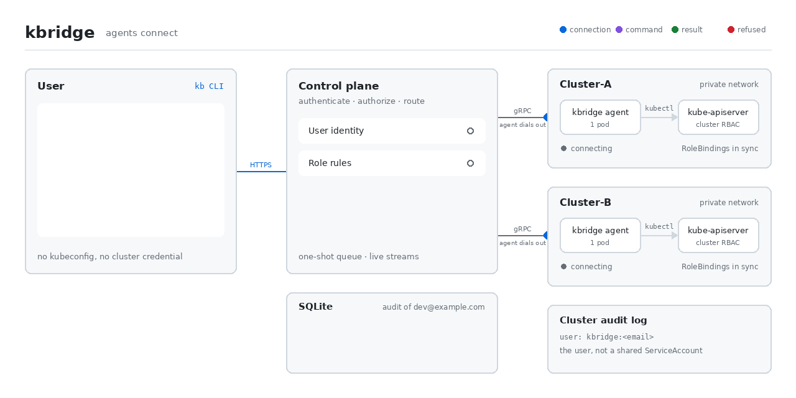

<picture>
  <source media="(prefers-color-scheme: dark)" srcset="docs/assets/kbridge-logo-dark.svg">
  
</picture>


A lightweight access gateway that lets you manage multiple Kubernetes clusters from a central control plane, without needing to distribute kubeconfig files, open inbound firewall rules, or set up VPN access.

<picture>
  <source media="(prefers-color-scheme: dark)" srcset="docs/assets/demo.gif">
  
</picture>

> **Status: alpha** (`v0.3.1-alpha.1`). Config keys, the RBAC policy schema,
> and REST API paths may change between releases, and it is not yet recommended
> for unattended production use.

## How it works

<picture>
  <source media="(prefers-color-scheme: dark)" srcset="docs/assets/architecture.gif">
  
</picture>

1. **Each cluster runs a small agent** that dials out to the control plane over
   gRPC. No inbound port is opened and no kubeconfig leaves the cluster.
2. **You run `kb` with kubectl syntax.** The CLI sends your login token and the
   command to the control plane.
3. **The control plane checks the command**: the role rules decide whether it
   runs. Nothing reaches a cluster without passing this one chokepoint.
4. **The agent runs kubectl as you.** kubectl holds no credential of its own; it
   goes through a loopback proxy in the agent that impersonates
   `kbridge:<your email>`, so the cluster's RBAC and its own audit log see the
   user, not the agent. The agent keeps RoleBindings in step with the policy.
5. **The result comes back and the attempt is recorded**, whether it ran or was
   refused: user, cluster, command, and outcome, in the kbridge audit log.

<picture>
  <source media="(prefers-color-scheme: dark)" srcset="docs/assets/console.gif">
  
</picture>

The kbridge admin account also gets a read-only web console at the control
plane root (`/`); see [docs/console.md](docs/console.md).

## Start here

### Run your own kbridge

kbridge is self-hosted: you run the control plane and an agent in each
cluster. Follow the [Helm quick start](docs/installation.md#quick-start-helm-one-cluster).
It puts the control plane and an agent on one cluster (kind works) in about
20 minutes, and ends on a refused command and its audit entry.

### You are taking it to production

1. [Production install](docs/production-install.md): Secrets, TLS, more clusters.
2. [Security hardening](docs/security.md): the checklist before users arrive.
3. [Onboard a user](docs/admin.md#onboard-a-user): the first users, their roles
   and their first password.
4. [Operations](docs/operations.md): backup, upgrades, troubleshooting.

### You have a kbridge account

Your admin gave you a control plane URL, an email and a password. Install
`kb` (Linux or macOS):

```bash
curl -fsSL https://raw.githubusercontent.com/why-xn/kbridge/master/install.sh | sh
```

The first login asks for the control plane URL and saves it in
`~/.kbridge/config.yaml`:

```bash
kb login
# Control plane URL: https://kbridge.example.com
# Email: you@example.com
# Password:
# Login successful.
kb clusters list
kb clusters use <cluster>
kb get pods -n <namespace>
```

If login fails with `x509: certificate signed by unknown authority`, your
control plane uses a private CA: get the CA file from your admin and run
`export SSL_CERT_FILE=/path/to/ca.crt` (Linux), or add it to your system trust
store. The export lasts only for that shell: add it to your shell profile
(`~/.bashrc`, `~/.zshrc`) so every new terminal has it. If an admin chose your
first password, [change it](docs/cli.md#change-your-password) now. Then read the
[CLI reference](docs/cli.md), including
[when a command is refused](docs/cli.md#when-a-command-is-refused).

## Problem

Giving an engineer access to a Kubernetes cluster usually means handing out a
kubeconfig or exposing the API server. That creates three problems that compound
with every new cluster, team, and environment.

- **Credential sprawl.** Every developer needs a kubeconfig for every cluster.
  Distributing, rotating, and revoking those credentials does not scale, and a
  credential on a laptop is a credential that can leak.
- **Network exposure.** Cluster API servers sit behind firewalls, so granting
  access means a VPN, a bastion, or a public endpoint. Each one is more attack
  surface to maintain.
- **Records that do not answer the question.** Reconstructing who did what means
  stitching together logs from several clusters, and a shared credential makes
  the cluster's own audit log name the credential rather than the person.

The same applies to automation and AI agents: give one its own kbridge account
and it holds no cluster credential, and every command it runs is checked
against its role and recorded under its name.

## Solution

kbridge puts a **control plane** between people and clusters. Nobody holds
cluster credentials: the user runs a CLI, each cluster runs a small agent that
dials *outbound*, and every command is checked before it is forwarded. No inbound
ports, no kubeconfig distribution, no VPN.

1. **Control plane (`kbridge-control-plane`)** authenticates the user, decides
   whether the command may run, routes it, and records the outcome. The one place
   access is granted and revoked.
2. **Cluster agent (`kbridge-agent`)** runs inside each cluster, opens an
   outbound gRPC connection, runs approved commands with kubectl as the
   requesting user, and returns the result. Because it dials out, no firewall
   change is needed, and because it holds the credentials, the control plane
   never does.
3. **CLI (`kb`)** speaks REST to the control plane with familiar kubectl syntax,
   so `kb get pods` works with no local credentials and no network path to the
   cluster.

What that changes:

| Problem | What kbridge does |
|---|---|
| Credential sprawl | Users authenticate to the control plane; cluster credentials never leave the agent, and access is revoked centrally |
| Network exposure | The agent dials out, so no inbound port, bastion, or VPN is required |
| Records that do not answer the question | One audit log across every cluster: who ran which command where, and whether it ran. Commands run as the user, so the cluster's own audit log names them too |

**Security in brief.** Users never hold a cluster credential; only the agent
does. Commands run as `kbridge:<email>` through impersonation, so the
cluster's RBAC and audit log see the person. Every attempt, allowed or
refused, is in the kbridge audit log. See [docs/security.md](docs/security.md)
and an [example policy](docs/rbac.md#example).

See the [roadmap](https://github.com/why-xn/kbridge/blob/master/ROADMAP.md)
on `master` for what is shipped, in progress, and planned.

## Documentation

| | Guide | Contents |
|---|---|---|
| **Use** | [CLI reference](docs/cli.md) | Every command; what to do when one is refused |
| | [Admin console](docs/console.md) | The read-only web console at the control plane root |
| **Install** | [Installation](docs/installation.md) | Helm quick start; CLI, Docker, from source |
| | [Production install](docs/production-install.md) | Secrets, TLS, and agents in other clusters |
| **Operate** | [Admin guide](docs/admin.md) | Onboard a user, agent tokens, audit logs |
| | [RBAC](docs/rbac.md) | Policy file format, cluster bindings, reloading |
| | [Security hardening](docs/security.md) | Hardening checklist, two-layer authorization, limits |
| | [Operations](docs/operations.md) | Backup, upgrades, token rotation, troubleshooting |
| **Reference** | [Configuration](docs/configuration.md) | Every option and environment variable, incl. TLS |
| | [API reference](docs/api.md) | All HTTP endpoints |

## License

[Apache License 2.0](LICENSE)
